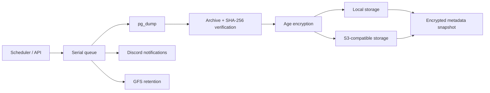

# Backup Manager

[](https://github.com/MD2SA/backup-manager/actions/workflows/ci.yml)
[](https://github.com/MD2SA/backup-manager/actions/workflows/postgres-matrix.yml)
[](https://github.com/MD2SA/backup-manager/actions/workflows/recovery-drill.yml)
[](https://go.dev/)
[](#compatibility)
[](LICENSE)

Self-hosted PostgreSQL backup service with scheduled dumps, verified restores,
encryption, local/S3 storage, GFS retention and disaster recovery for its own
state.

> **Status:** production-ready for a single PostgreSQL instance.
> The supported target range is PostgreSQL 13–18. See the
> [production checklist](docs/guides/CONFIGURATION.md#production-checklist)
> before deploying.

---

## Why Backup Manager

- **Verified backups, not just files.** Every dump is checked for archive
  integrity and a SHA-256 checksum before it is uploaded.
- **Recovery is a first-class feature.** Metadata and data can be recovered
  from local storage, S3 or a single artifact, with dry-run and verify-only
  modes.
- **Designed for unattended operation.** Scheduler, serial queue, GFS retention,
  Discord notifications, overdue alerts, Prometheus metrics and audit logs.
- **Boring to run.** One Go binary, one PostgreSQL metadata database, one
  target database, Docker or a single binary.

## Compatibility

| Area | Supported |
|---|---|
| Target database | PostgreSQL 13–18 |
| PostgreSQL client | 18.x in the container; newer clients can dump older servers |
| Storage | local filesystem, S3 and S3-compatible |
| Notifications | Discord webhooks |
| Authentication | API keys, single admin role |
| Deployment | Docker, Docker Compose, binary |
| Metadata database | PostgreSQL |
| PITR / WAL | not included |
| Multiple database engines | not included |
| Multi-tenant / RBAC | not included |
| High availability / multiple replicas | not included |

See [configuration](docs/guides/CONFIGURATION.md) for the full reference and the
[architecture](docs/guides/ARCHITECTURE.md) for design decisions.

---

## Quick start (Docker Compose)

Requirements: Docker with Compose.

```bash
git clone https://github.com/MD2SA/backup-manager.git
cd backup-manager

cp .env.example .env
# Edit .env: set POSTGRES_PASSWORD and APP_BACKUP_PATH.

docker build -t backup-manager:local .
docker run --rm -it -u "$(id -u):$(id -g)" \
  -v "$PWD:/work" -w /work \
  backup-manager:local init --docker

IMAGE_TAG=backup-manager:local docker compose up -d
```

Check it:

```bash
curl http://localhost:8080/healthz
curl http://localhost:8080/readyz
IMAGE_TAG=backup-manager:local docker compose run --rm backup-manager config check --connect
```

`init --docker` writes `config.yaml` and `secrets.env` (mode `0600`) and uses
`metadata-db` as the metadata host. The generated admin key is stored as
`ADMIN_KEY` in `secrets.env` and printed once by `init`.

Then create a retention policy, a storage provider and a profile through the
API. The [API guide](docs/guides/API.md) has the full request sequence.

### Quick start (from source)

Requirements: Go 1.26+, PostgreSQL 13–18 and `pg_dump`, `psql`, `pg_restore` in
`PATH`.

```bash
go run ./cmd/api init --metadata-host localhost --storage-path ./backups
go run ./cmd/api config check --connect
go run ./cmd/api serve
```

Or use the Makefile:

```bash
make init
make config-check
make run
```

---

## How it works



A backup is queued, dumped, verified, optionally encrypted, uploaded to every
storage provider, and then pruned according to the profile's retention policy.
An encrypted snapshot of the manager's own state rides along with the backup.

Restores are asynchronous jobs: download, decrypt, verify checksum, preflight an
empty target database, then apply with `psql` or `pg_restore`. Backups and
restores share a target database gate and never overlap.

---

## Core features

| Area | What you get |
|---|---|
| Backups | cron schedules, manual trigger, serial queue, gzip/SQL, verification and checksums |
| Storage | multiple destinations per profile: local and S3-compatible |
| Encryption | Age passphrase or X25519 keypair, encrypted provider credentials at rest |
| Retention | GFS hourly/daily/weekly/monthly/yearly, pinned backups, per-provider cleanup |
| Restore | asynchronous jobs, checksum verification, empty-target preflight, logs and history |
| Recovery | `verify`, `recover metadata`, `recover data`, local/S3 discovery and artifact-only recovery |
| Operations | overdue detection, Discord alerts, Prometheus metrics, audit log, version endpoint |
| Security | API keys, rate limiting, CORS, trusted proxies, request IDs, production config gate |
| Reliability | single-instance advisory lock, operation timeouts, interrupted-job reconciliation |

## Recovery

```bash
# Validate a backup without touching the target
backup-manager verify --config /etc/backup-manager/config.yaml --execution <id>

# Rebuild the manager state after metadata loss
backup-manager recover metadata --config ... --list
backup-manager recover metadata --config ...

# Recover the latest successful backup of a profile
backup-manager recover data --config ... --profile <profile-id> --confirm

# Or from S3 / from an artifact
backup-manager recover metadata --config ... \
  --s3-bucket my-backups --s3-prefix meta/
backup-manager recover data --config ... --file backup.sql.gz --confirm
```

`recover data` supports `--verify-only`, `--target-dsn`,
`--terminate-connections` and a metadata-database safety guard.

Keep an **off-host recovery kit**: `config.yaml`, `secrets.env`,
`CONFIG_ENCRYPT_KEY`, the Age private key or metadata passphrase, S3 credentials
and the image tag. Details in the
[operations runbook](docs/guides/OPERATIONS.md#recovery-after-host-loss).

---

## Configuration

Backup Manager uses two files:

| File | Purpose | Permissions |
|---|---|---|
| `config.yaml` | non-secret settings: server, storage, databases, retention defaults | `0644` |
| `secrets.env` | passwords, API keys and encryption keys | `0600`, never commit |

`config.yaml` references secret names; values are read from `secrets.env`. The
service does not load `.env` and does not read configuration from the process
environment except `APP_CONFIG_PATH` and `APP_SECRETS_FILE`.

Generate and validate:

```bash
backup-manager init
backup-manager config check --connect
```

Templates: [`config.example.yaml`](config.example.yaml),
[`secrets.example.env`](secrets.example.env).

---

## Production checklist

- [ ] Generate `config.yaml` and `secrets.env`; never commit either.
- [ ] `chmod 600 secrets.env`.
- [ ] Run `config check --connect` against the real metadata and target databases.
- [ ] Set `server.env: production`; backup encryption and `CONFIG_ENCRYPT_KEY` are then required.
- [ ] Use a dedicated read role for backups and, optionally, a separate `restore_user`.
- [ ] Put the service behind a TLS-terminating proxy; set `cors_origins` and `trusted_proxies`.
- [ ] Run exactly one replica; the advisory lock refuses a second one.
- [ ] Pin the container image tag, not `latest`.
- [ ] Monitor `/readyz`, backup failures, overdue profiles and disk space.
- [ ] Keep the recovery kit off-host and test recovery before relying on it.

Full checklist: [Configuration guide](docs/guides/CONFIGURATION.md#production-checklist).
Operational procedures: [Operations runbook](docs/guides/OPERATIONS.md).

---

## Documentation

| Document | Contents |
|---|---|
| [Documentation home](https://md2sa.github.io/backup-manager/) | Published docs site |
| [Configuration](docs/guides/CONFIGURATION.md) | every field, secrets, production checklist, PostgreSQL compatibility |
| [Operations](docs/guides/OPERATIONS.md) | monitoring, upgrades, backup/restore, recovery after host loss |
| [API](docs/guides/API.md) | endpoints, auth, pagination and examples |
| [Architecture](docs/guides/ARCHITECTURE.md) | modules, backup lifecycle, design decisions |
| [Testing](docs/guides/TESTING.md) | unit, integration, S3 and container recovery drill |
| [Releasing](docs/guides/RELEASING.md) | versioning, tags, GHCR publishing, verification and rollback |
| [Observability](deploy/observability/README.md) | Prometheus rules and Grafana dashboard |
| [Changelog](CHANGELOG.md) | release history |
| [Contributing](CONTRIBUTING.md) | development, tests and pull requests |
| [Security](SECURITY.md) | vulnerability reporting and security model |

Swagger UI: `http://localhost:8080/swagger/index.html` while the service is
running.

---

## Development

```bash
make tools            # install Air, sqlc, goose, swag and golangci-lint
make init             # generate local config.yaml + secrets.env
make config-check     # validate configuration
make test             # fast tests, no database required
make test-integration # PostgreSQL integration tests (BACKUP_MANAGER_TEST_DSN)
make recovery-drill   # container disaster-recovery drill (Docker)
make docs-serve       # live documentation site
make docs-build       # strict documentation build
make lint             # golangci-lint
make fmt              # gofmt
make swagger          # regenerate OpenAPI docs
make sqlc             # regenerate database code
make migrate          # apply migrations
```

CI runs the fast suite, the PostgreSQL integration suite, the PostgreSQL 13–18
matrix, the S3 in-memory recovery test and the container recovery drill. See
[Testing](docs/guides/TESTING.md).

---

## Contributing

Contributions are welcome. Read [CONTRIBUTING.md](CONTRIBUTING.md) before
opening a pull request. Use [GitHub Discussions](https://github.com/MD2SA/backup-manager/discussions)
for questions and the issue templates for bugs and feature requests.

## Security

Please do not open public issues for vulnerabilities. See [SECURITY.md](SECURITY.md).

## License

MIT. See [LICENSE](LICENSE).
