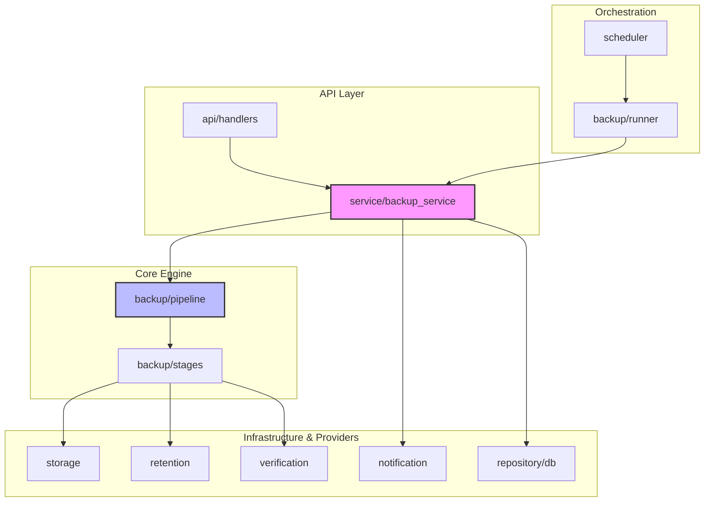
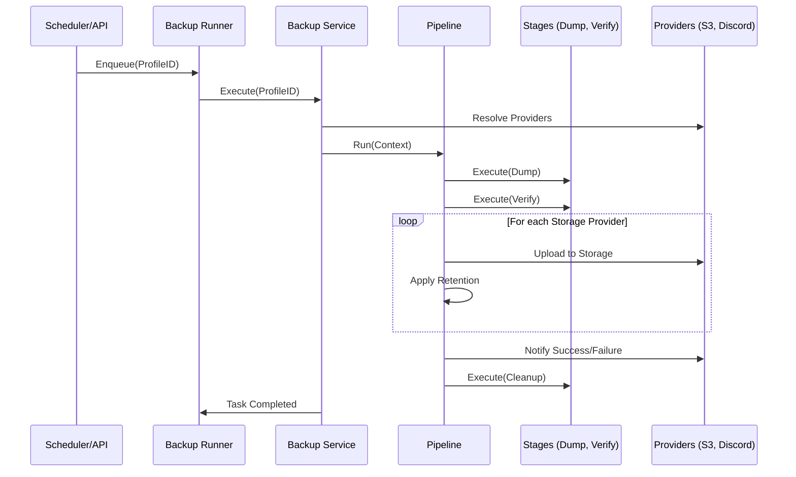

# Architecture Documentation

This document describes the high-level architecture of the Backup Manager and its internal components.

## Overview

Backup Manager is designed as a **Modular Monolith** using Go. It follows a layered approach where business logic is separated from infrastructure and external providers.

## Configuration and startup

Configuration is deliberately outside the runtime database:

- `config.yaml` holds non-secret settings (server, storage, database endpoints,
  encryption public key, metadata backup defaults).
- `secrets.env` holds passwords and keys and is read directly from disk; it is
  never exported into the process environment.
- `internal/config` parses both files with a strict schema (`version: 1`),
  resolves secret references, validates values and exposes a typed `Config`.
- `backup-manager config check` performs production preflight checks
  (permissions, binaries, directories, Age keys, cron, optional DB connectivity)
  and verifies that the PostgreSQL client binaries are new enough for the target
  server.
- `backup-manager serve` acquires a PostgreSQL advisory lock before running
  migrations, then applies pending migrations in-process and starts the HTTP
  server. The lock prevents two replicas from racing the schema or scheduling
  duplicate backups.
- `backup-manager init` generates a working pair of files, including keys.

### Core Components

1.  **API Handler (`internal/api`)**: Exposes REST endpoints for managing profiles, viewing execution history, and manual triggers.
2.  **Configuration (`internal/config`)**: Strict YAML config, secrets file, validation and `init`/`check` helpers.
3.  **Authentication (`internal/auth`)**: users, hashed API keys, bootstrap admin and audit log. Single admin role.
4.  **Scheduler (`internal/scheduler`)**: Manages one cron entry per enabled profile and reconciles the in-memory jobs with the database after every profile mutation.
5.  **Backup Runner (`internal/backup/runner.go`)**: A serial queue that accepts different profiles but never runs two backups at once. Duplicate profiles are rejected while pending/running.
6.  **Backup Pipeline (`internal/backup/pipeline.go`)**: Orchestrates the execution of multiple "Stages".
7.  **Providers (`internal/storage`, `internal/notification`)**: Pluggable implementations for different storage backends and notification channels.
8.  **Database (`internal/database`)**: pgx pool, in-process migrations and the single-instance advisory lock.
9.  **Recovery (`internal/recovery`)**: metadata snapshot discovery and restore, execution resolution, artifact selection and data restore.
10. **Maintenance (`internal/maintenance`, `internal/selfbackup`)**: audit retention and local metadata self-backup.
11. **Observability (`internal/metrics`, `internal/monitor`)**: Prometheus metrics, health summary and overdue detection. Overdue profiles notify their Discord providers at a configurable interval.

## System Components & Relationships

The following diagram illustrates how the different internal packages interact with each other:

## The Backup Lifecycle

When a backup is triggered (via Scheduler or API), the following flow occurs:

### 1. Triggering
A backup starts when a `ProfileID` is enqueued into the `BackupRunner`. The runner processes tasks sequentially.

### 1b. Restore jobs
Restores are separate asynchronous jobs stored in the `restores` table and
processed by `RestoreRunner`. The restore worker downloads the artifact,
decrypts it, verifies the recorded SHA-256 checksum, re-detects the format
(plain SQL, gzip or custom archive), preflights the empty target database and
applies it with `psql`/`pg_restore` inside a single transaction. Backups and
restores share a target database gate, so a dump and a restore never overlap.
Every uploaded copy is recorded in `execution_storage`.

### 2. Resolution
The `BackupService` fetches the profile from the database and uses the `ProviderService` to resolve linked Storage and Notification IDs into actual functional implementations (e.g., an S3 client or a Discord webhook client).

### 3. Pipeline Execution
The pipeline consists of several stages sharing an `ExecutionContext`:
*   **PostgresDumpStage**: Uses `pg_dump` to create a local compressed SQL file.
*   **VerificationStage**: Calculates checksums and verifies archive integrity.
*   **StorageStage**: (Iterative) Uploads the local file to all configured storage destinations.
*   **CleanupStage**: Removes the local temporary file.

After all uploads succeed, the service applies GFS (Grandfather-Father-Son)
retention once against every provider, finalizes the execution row, and uploads
an encrypted metadata snapshot. Retention failures are operational warnings,
not backup failures.

Every backup and restore is bounded by `operations.backup_timeout` and
`operations.restore_timeout`. The timeout context covers dump, download,
decryption and apply, while the parent context remains available for the final
status update and notifications.

### 4. Notification
At the start, success, or failure of the pipeline, the service iterates through all linked notification providers to broadcast the status. A separate overdue worker notifies when a profile stops producing successful backups, with per-episode deduplication.

### 5. Recovery
`internal/recovery` is shared by `verify`, `recover metadata` and `recover data`.
It supports local and S3 snapshot discovery, explicit files, multiple passphrase
candidates, Age identities, per-provider artifact fallback, checksum
verification, target preflight and a guard that refuses to restore into the
metadata database.

## Design Patterns

### Stage Pattern
The `backup` package uses a stage-based approach. Each `Stage` interface has a `Name()` and an `Execute(*ExecutionContext)` method. This makes it trivial to add new steps like "Encryption" or "Cloud SQL Proxy" without changing the core engine.

### Provider Interface
Storage and Notification providers are defined by interfaces. New providers can be added by implementing these interfaces and registering them in the `storage.NewProvider` or `notification.NewProvider` factories.

### Repository (SQLC)
We use `sqlc` to generate type-safe Go code from raw SQL. This ensures that our database interactions are performant and catch errors at compile-time rather than runtime.
