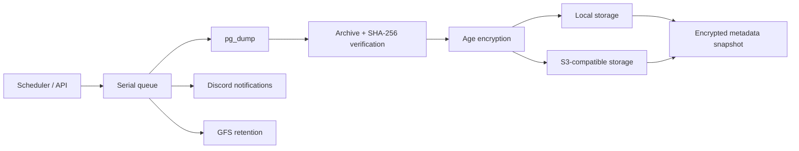

# Backup Manager

Self-hosted PostgreSQL backup service with scheduled dumps, verified restores,
encryption, local/S3 storage, GFS retention and disaster recovery for its own
state.

**Production-ready for a controlled, single PostgreSQL instance.** Supported
target range: **PostgreSQL 13–18**.

## Start here

| I want to… | Read |
|---|---|
| Install and run it | [Configuration](guides/CONFIGURATION.md) |
| Understand the design | [Architecture](guides/ARCHITECTURE.md) |
| Call the API | [API reference](guides/API.md) |
| Operate it safely | [Operations runbook](guides/OPERATIONS.md) |
| Recover after a host loss | [Recovery after host loss](guides/OPERATIONS.md#recovery-after-host-loss) |
| Run the test suite | [Testing](guides/TESTING.md) |

## What it does

- Scheduled PostgreSQL logical backups via cron and manual triggers.
- Archive verification and SHA-256 checksums before upload.
- Age encryption (passphrase or X25519 keypair).
- Multiple destinations per profile: local and S3-compatible.
- GFS retention with pinned backups.
- Asynchronous restores with logs, history and empty-target preflight.
- Metadata snapshots embedded in every backup, plus local self-backup.
- `verify`, `recover metadata` and `recover data` CLI workflows.
- Discord notifications, including overdue profiles.
- Authenticated Prometheus metrics, audit log and overdue detection.
- API key authentication, rate limiting, CORS and trusted proxies.

## What it does not do

- PITR / WAL archiving.
- MySQL, MongoDB, SQL Server or other database engines.
- Multi-tenant or role-based access control.
- High availability or multiple active replicas.
- Built-in TLS termination (run it behind a reverse proxy).

## How it works



## Quick start

```bash
git clone https://github.com/MD2SA/backup-manager.git
cd backup-manager

cp .env.example .env
# Edit .env: set POSTGRES_PASSWORD and APP_BACKUP_PATH.

docker build -t backup-manager:local .
docker run --rm -it -u "$(id -u):$(id -g)" \
  -v "$PWD:/work" -w /work \
  backup-manager:local init --docker

IMAGE_TAG=backup-manager:local docker compose up -d
```

Check it:

```bash
curl http://localhost:8080/healthz
curl http://localhost:8080/readyz
IMAGE_TAG=backup-manager:local docker compose run --rm backup-manager config check --connect
```

## Container images

```bash
docker pull ghcr.io/md2sa/backup-manager:1.0.0
```

Stable releases may also be mirrored to Docker Hub. Use an exact version in
production.

## Recovery first

```bash
# Validate without touching the target
backup-manager verify --config /etc/backup-manager/config.yaml --execution <id>

# Rebuild the manager state
backup-manager recover metadata --config ... --list
backup-manager recover metadata --config ...

# Recover data
backup-manager recover data --config ... --profile <profile-id> --confirm
```

Keep `config.yaml`, `secrets.env`, `CONFIG_ENCRYPT_KEY`, the Age private key or
metadata passphrase, S3 credentials and the image tag in an off-host recovery
kit.

See [Operations](guides/OPERATIONS.md#recovery-after-host-loss) for the complete
procedure.

## Project

- [GitHub repository](https://github.com/MD2SA/backup-manager)
- [Changelog](https://github.com/MD2SA/backup-manager/blob/main/CHANGELOG.md)
- [Contributing](https://github.com/MD2SA/backup-manager/blob/main/CONTRIBUTING.md)
- [Security policy](https://github.com/MD2SA/backup-manager/blob/main/SECURITY.md)
- [License](https://github.com/MD2SA/backup-manager/blob/main/LICENSE)
